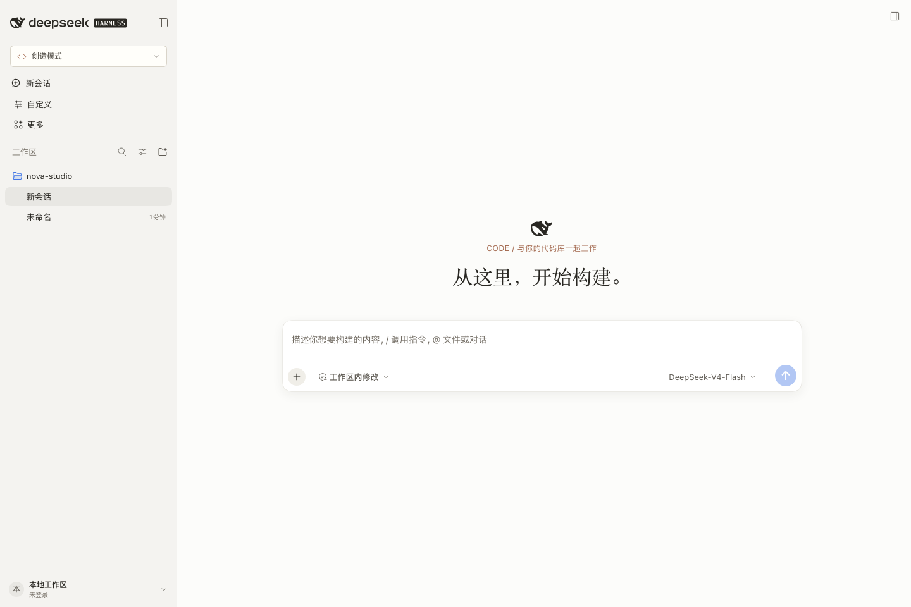
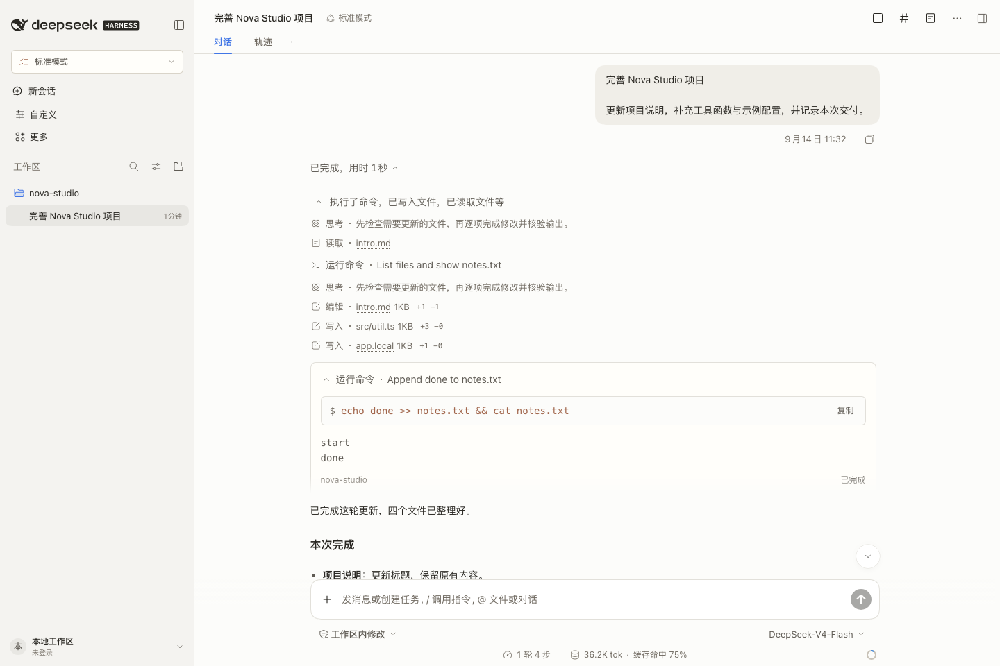
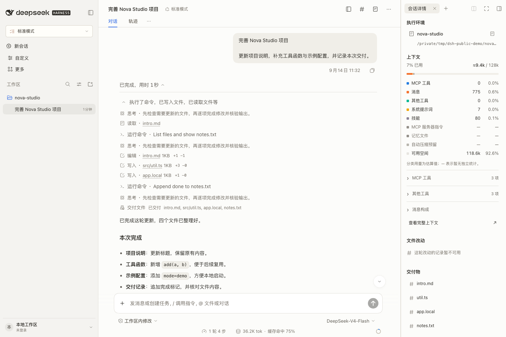
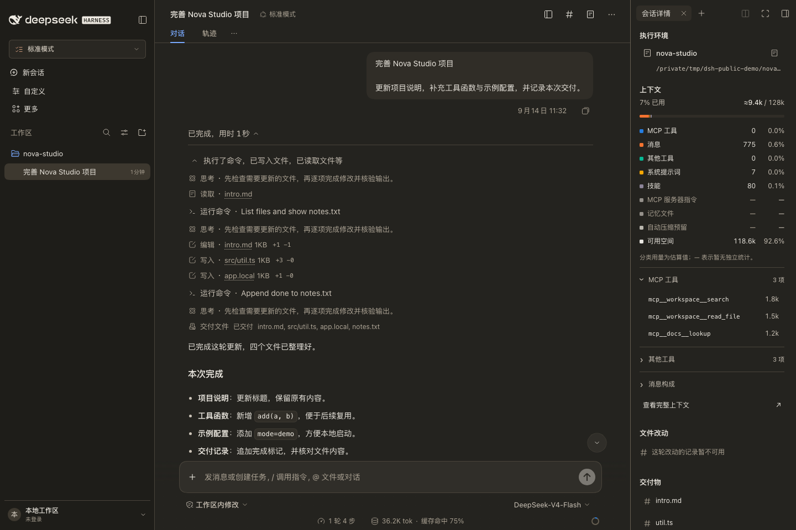

# DSH Claude Code UI

为 **DeepSeek Harness** 提供 Claude Code 桌面端风格的社区界面插件。围绕代码会话、终端执行、审批与交付组织界面，继续使用 DSH 原生模型、权限、工作区和插件能力。

**当前预览版：v0.1.11 · 适配 DSH 0.2.2-alpha.2 · 包名：`dsh-claude-ui`**

[下载与安装](https://github.com/003jia/dsh-Claudecode-ui/releases/tag/v0.1.11) · [更新记录](CHANGELOG.md) · [界面图库](docs/screenshots.md)



> 图片由当前版本在隔离 DSH 环境中实际渲染，使用公开示例会话与演示数据，不包含个人账户、真实工作项目或凭据。详细截图说明见[图库](docs/screenshots.md)。

## 这一版更新了什么

相较首个公开版本 v0.1.7，本次合并了 v0.1.8–v0.1.11 的界面改进：

- **回复更连贯**：连续正文排版，优化标题、段落、列表和表格的阅读间距。
- **终端更清楚**：Bash 的命令、输出、目录和退出状态分别展示；保留 ANSI、复制、原始输入输出和原生执行行为。可见的运行中命令自动展开一次，手动收起后不会反复打开。
- **输入、审批、交付更紧凑**：合适宽度下采用轻量输入框，模型与权限位于下方；审批、文件预览、差异和交付继续使用 DSH 原生入口。
- **右栏按需打开**：进入或返回会话时收起恢复的右栏；详情改为扁平分区，显示执行环境、上下文和有数据的任务、改动、交付物。
- **上下文展示更完整**：用量、容量、分段条和九类图例；MCP 工具、其他工具和消息组成可展开，明细列表不截断数量。
- **桌面导航更轻**：紧凑左栏、调整字号与账户行；保留原生品牌与鲸鱼，移除主页重复“任务设置”；macOS 收起左栏后保留账户入口。

## 功能一览

| 区域 | 可用能力 |
| --- | --- |
| 工作区与会话 | 左侧按项目展开会话；保留新建、切换、搜索、归档和项目菜单 |
| 工作模式 | 读取 DSH 注册的内置、插件与自定义 Agent 预设；支持从菜单进入自定义预设设置 |
| Code 会话 | 连续回复、运行中工具、命令输出、审批、文件改动与交付物 |
| 上下文圆环 | 查看用量与分类、打开详细分布、通过原生 `/compact` 压缩上下文 |
| 会话详情 | 工作目录、上下文明细，以及当前会话提供的任务、待处理、后台任务、改动和交付 |
| 账户与外观 | 原生账户菜单、语言和明暗切换、桌面更新入口、字体和内容宽度偏好 |
| 扩展兼容 | 保留原生设置、模型选择、输入扩展、附件、会话视图、工具渲染和右侧标签 |

显式选择工作模式通过原生 Agent 预设接口作用于尚未开始的会话；已开始或只读的会话保持原生限制。安装和加载界面不会更改模型服务商、凭据、权限或新任务默认模式。

## 界面预览

### 回复与终端



### 会话详情与上下文



### 深色主题



[查看全部图片与场景说明 →](docs/screenshots.md)

## 安装或升级

1. 从 [v0.1.11 Release](https://github.com/003jia/dsh-Claudecode-ui/releases/tag/v0.1.11) 下载 `dsh-claude-ui-0.1.11.tgz`。
2. 在 DSH 桌面端的「插件」中选择本地安装，添加下载的 `.tgz`；已装旧版时使用同一个包升级。
3. 在插件详情「包含的组件」中确认 `dsh-claude-ui` 已启用。若已启用另一款接管整体外观的界面插件，先关闭其界面组件。
4. 等当前任务结束后，按 DSH 提示重新打开应用，让客户端加载新界面。

功能插件可以继续保留。要恢复原生界面，在本插件详情中停用 `dsh-claude-ui` 组件。

## 兼容性与统计说明

目标版本是 **DSH 0.2.2-alpha.2**。回复、Bash、输入框、账户和侧栏有针对该版本的 DOM/布局适配，升级 DSH 后需要重新验证。

- 模型、权限、审批、Session、设置、文件预览和差异由 DSH 管理。未知输入结构、附件预览、较窄输入列或活动扩展会保留原生输入布局。
- 右栏默认收起不移除已保存标签；第三方插件仍可通过原生入口打开文件或面板。右栏宽度仍可使用 DSH 的拖拽调整。
- 上下文分类使用当前会话提供的估算数据。缺少独立测量的项目显示 `—`，不填造 0；分类与总用量不一定逐项精确相加。
- `dsh-context` 可提供更多工具/消息明细和完整上下文页面；未安装或数据不可用时显示明确提示。
- 文件拖放由 DSH 原生附件组件接收。若与旧 `dsh-meme@0.1.72` 同用且拖放无响应，需要检查该插件的草稿预览插槽冲突。
- 本项目不是 Anthropic 或 DeepSeek 官方产品，未声称兼容所有第三方插件或所有 DSH 版本。

## 从源码构建

需要 Node.js **24.9+** 和已安装依赖、已构建的 [DeepSeek Harness 源码](https://github.com/deepseek-ai/deepseek-harness)，版本为 `0.2.2-alpha.2`。工具链和运行包从该源码目录复用。

```sh
export DSH_SOURCE=/absolute/path/to/deepseek-harness
npm run build
npm test
npm pack --ignore-scripts
```

公开仓库的 `npm test` 覆盖模式目录、上下文数据、右栏恢复、输入布局与运行中终端展开。单元检查、真实 Loader 验证和演示截图的范围见[验证说明](docs/validation.md)。截图演示不代表真实模型调用或全部已安装插件的组合验收。

## 许可证

[MIT](LICENSE)。发行包内联的 DeepSeek Harness 工具代码保留其上游 MIT 许可，见[第三方许可](THIRD_PARTY_NOTICES.md)。字体使用本机字体栈与系统回退，未打包商业字体。
