# v0.1.11 界面图库

全部图片使用 v0.1.11 构建，在隔离的 DSH Web 客户端中实际渲染，尺寸为 **1440 × 960**。项目、会话和上下文补充分项均为演示数据，不包含个人账号、私人项目或 API 密钥。

命令场景使用本地录制模型响应，由原生 DSH 在临时示例项目中执行审批和命令。运行图展示执行状态，命令结算后显示实际输出。macOS 收起账户图在隔离客户端启用对应平台条件，不能替代正式 Electron 实机验收。

[返回项目介绍](../README.md) · [验证说明](validation.md)

## 首页与紧凑侧栏

创造模式首页，紧凑侧栏与原生输入框。

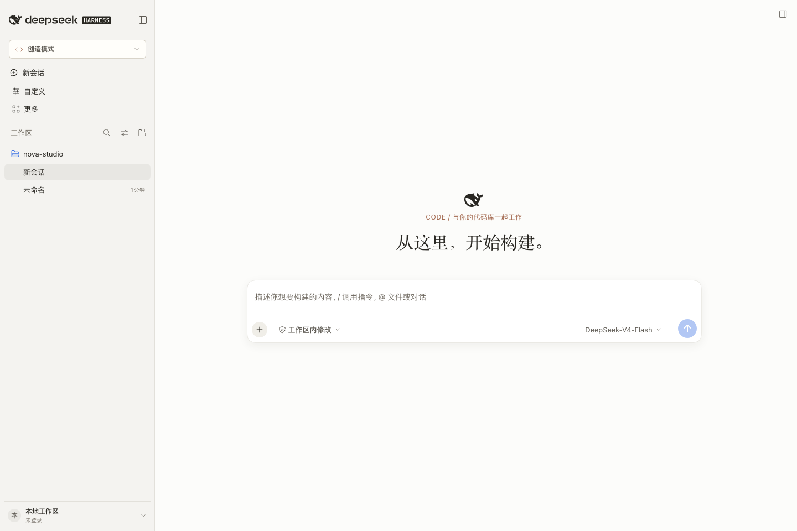

## 工作模式选择

读取原生预设目录的工作模式菜单。

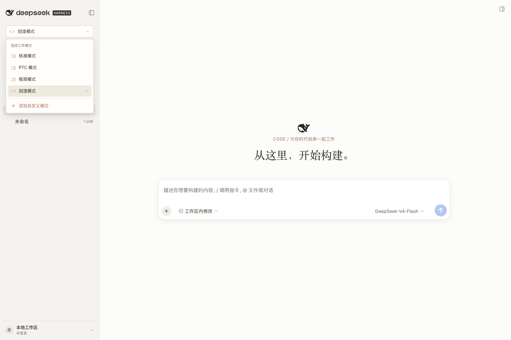

## 连续回复与完成交付

连续回复、交付文件与会话输入区。

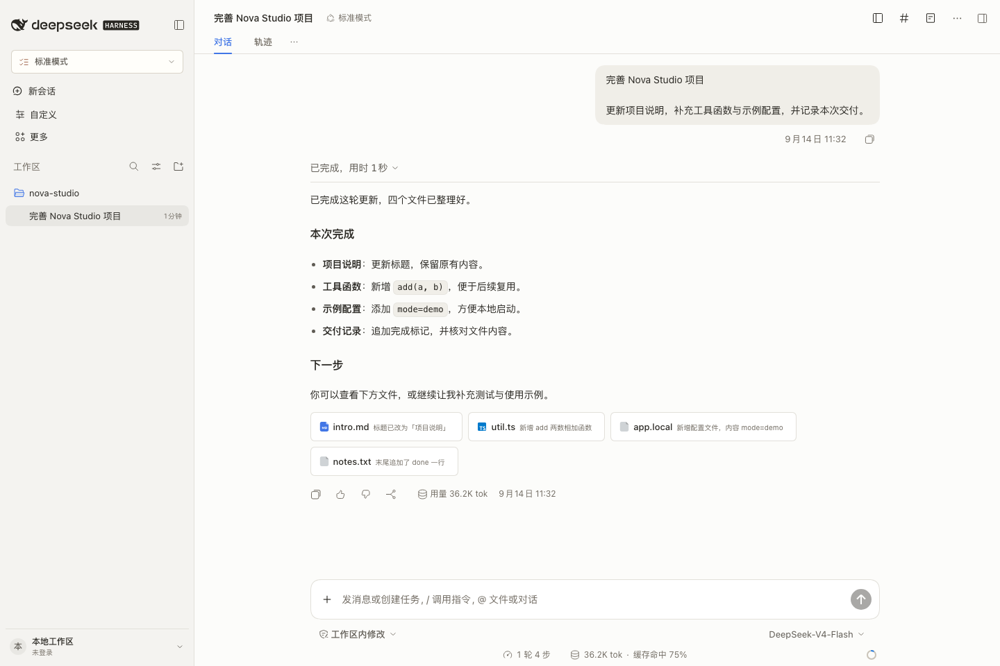

## 终端命令与输出

原生命令卡片，分开显示命令、输出、工作目录与退出状态。

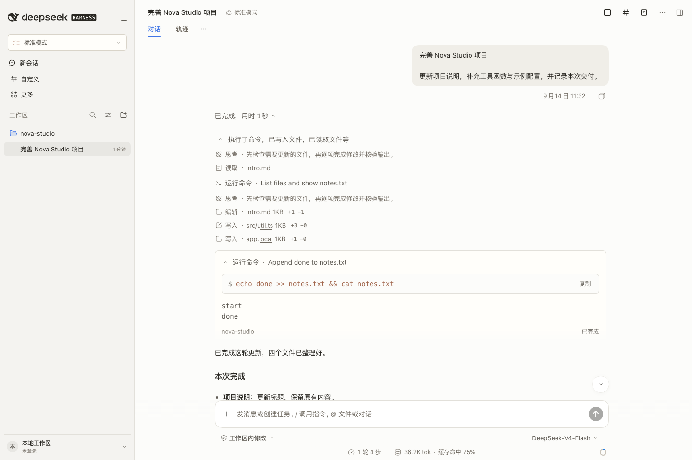

## 会话详情与完整上下文分类

300px 原生详情侧栏与完整上下文分类。

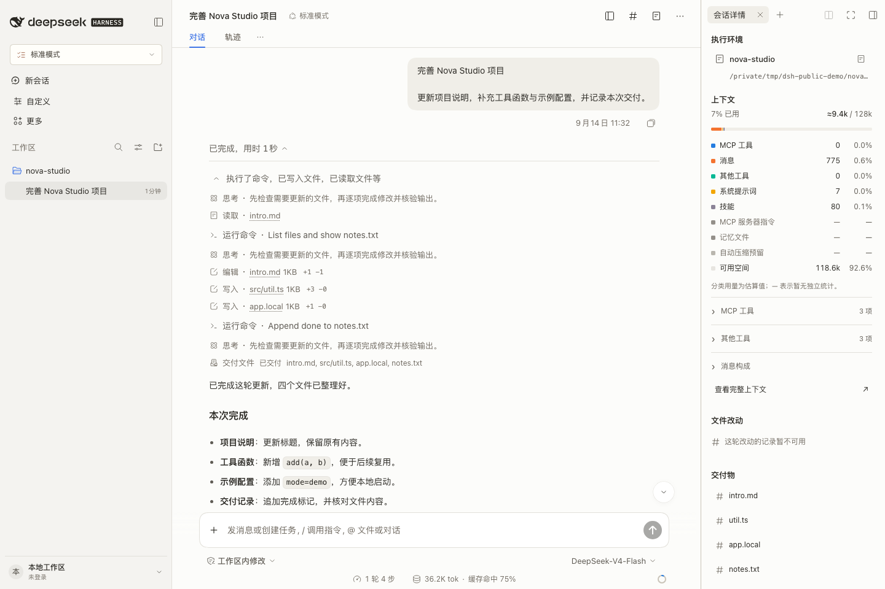

## 展开工具明细

可展开的全部工具定义明细；示例数据通过原生投影提供。

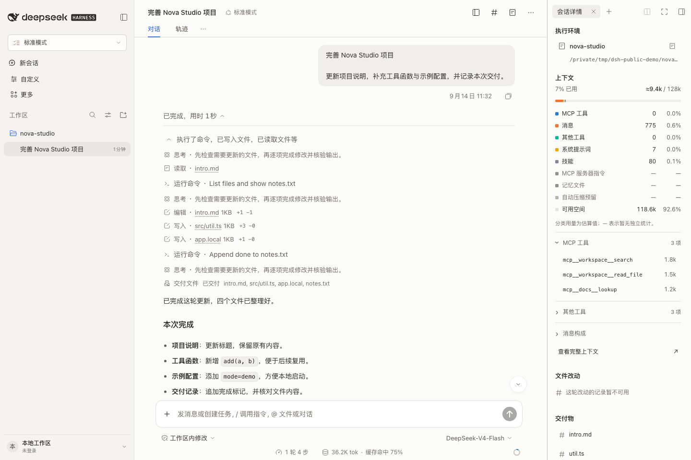

## 深色主题

深色主题，包含已选中会话和上下文详情。

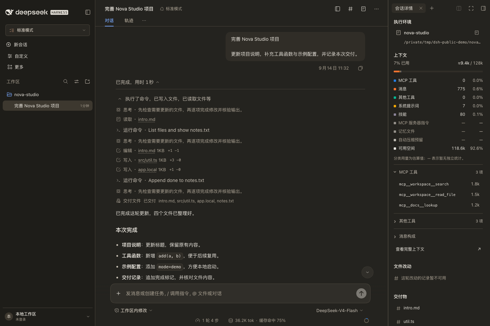

## 收起侧栏后的账户入口

macOS 平台条件演示：折叠侧栏后的独立头像与原生账户菜单。

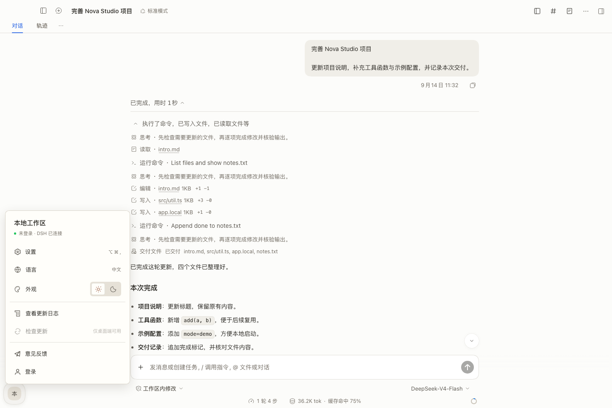

## 等待审批

真实原生等待审批状态；操作仅写入临时演示项目。

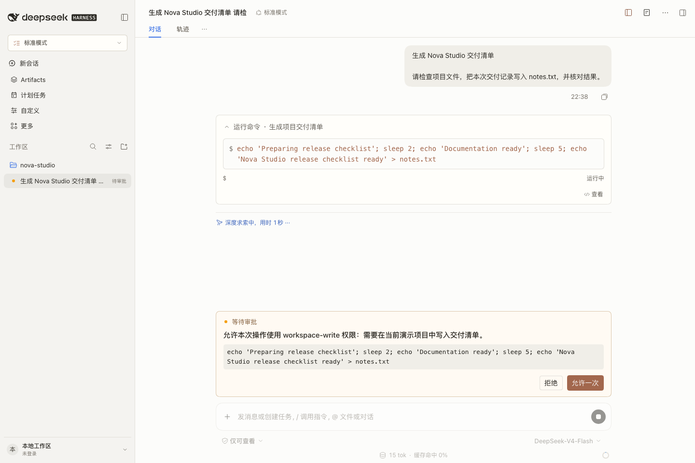

## 命令运行中

原生命令执行中状态与停止入口；模型响应来自明确的本地回放。

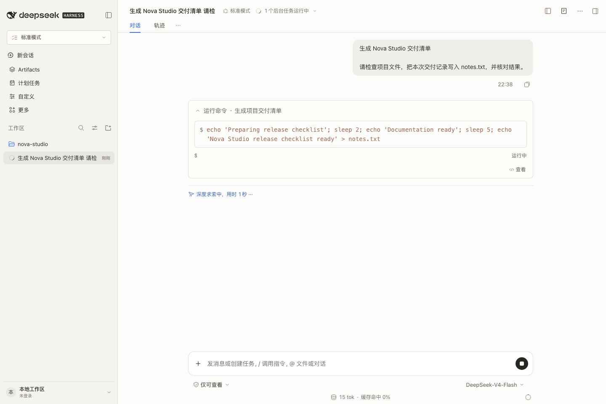

## 命令完成与实际输出

命令完成后原生输出区显示实际 stdout 与完成状态。

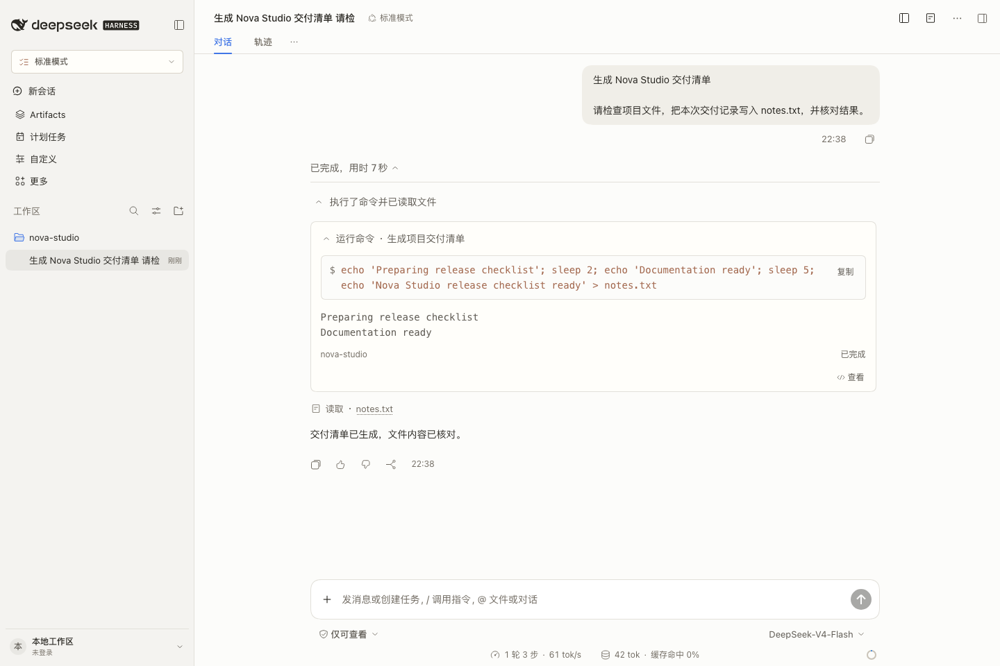
